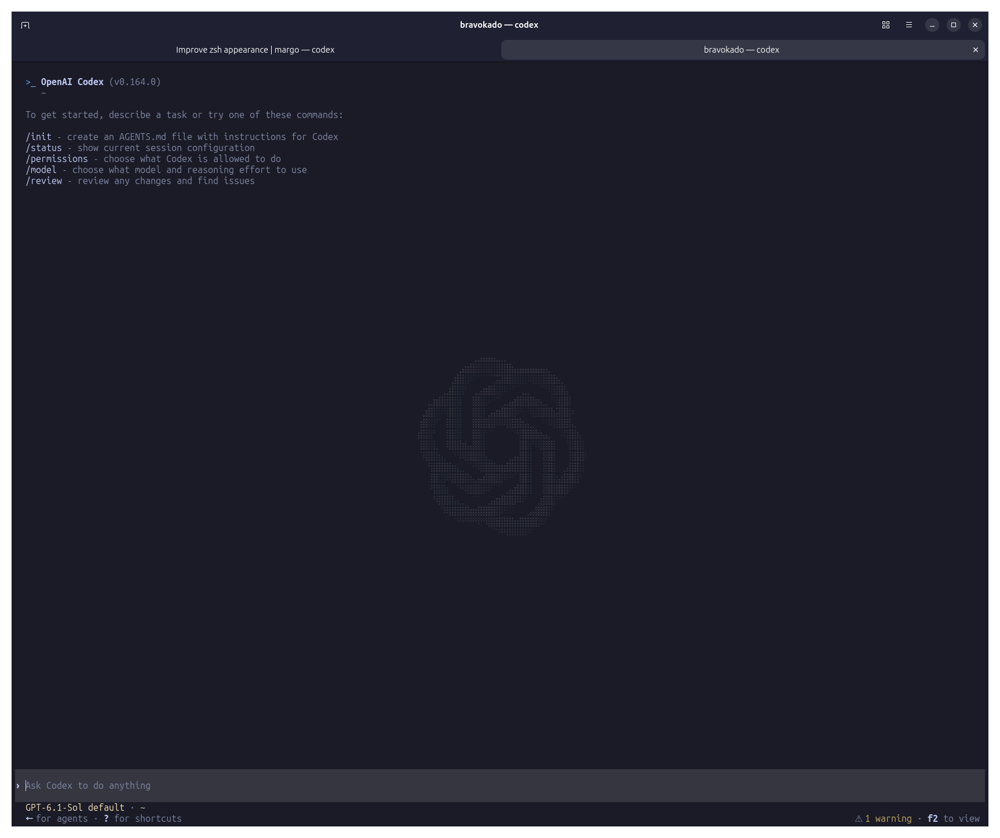
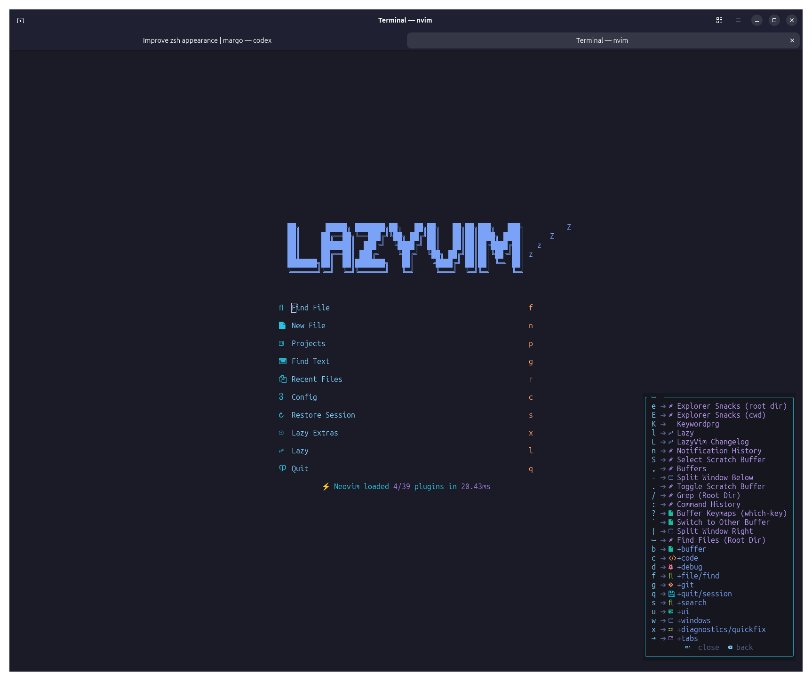

<div align="center">

# Ubuntu Workspace

**A dark terminal. A fast editor. A workstation ready to build.**

Zsh · Starship · LazyVim · tmux · Tokyo Night

</div>




## The look: Tokyo Night 🌙

Deep navy backgrounds, soft blue and purple accents, and readable text without a wall of prompt decorations. The terminal and editor share the Tokyo Night palette so moving between your shell and code feels consistent.

- **Tokyo Night** — the Ptyxis terminal palette and Neovim colourscheme.
- **Ubuntu Mono, 12pt** — compact, readable terminal text with normal character and line spacing.
- **Symbols Nerd Font Mono** — fallback glyphs for folder, file and Git icons.
- **Starship** — a two-line prompt with directory and Git context, command duration, and language versions on the right.
- **eza** — coloured file listings with icons and directories grouped first.
- **Ptyxis** — a dark interface, normal cell spacing and an I-beam cursor.

> **Work in progress:** the screenshots show the configured desktop. The scripts currently install the tools below and deploy configuration templates, but do not yet install Starship, eza or fonts, or apply Ptyxis appearance settings. Codex is shown in the preview and is not installed by these scripts. A unified laptop installer and a clean-machine test are still pending.

## Getting started

From this repository's directory, preview each stage:

```bash
./install-terminal.sh --dry-run
./install-languages.sh --dry-run
./install-development.sh --dry-run
./install-research.sh --dry-run
```

Then run the stages you want, in order:

```bash
./install-terminal.sh
./install-languages.sh
./install-development.sh
# Optional: web/API and network research tools
./install-research.sh
```

Run as your normal user; the scripts request sudo for system packages. Network access is required. The terminal installer requires **Neovim 0.11.2 or newer**; the version available through apt depends on your Ubuntu release. Pinned research binaries currently support **Linux x86_64**.

## Terminal & editor

```bash
./install-terminal.sh
```

Installs:

- **Zsh** — interactive shell, set as the login shell after validation.
- **zsh-autosuggestions** — suggestions from command history.
- **zsh-syntax-highlighting** — visual feedback as you type.
- **Neovim + LazyVim** — editor, plugin manager and the included configuration.
- **tmux** — persistent terminal sessions and split panes.
- **ripgrep** — fast text search.
- **fd-find** — file search; available through the `fd` alias.
- **fzf** — fuzzy selection, history search and shell completion integration.
- **bat** — syntax-highlighted file viewing through the `bat` alias.
- **zoxide** — directory jumping with `z`.
- **Git** — version control and plugin downloads.
- **curl** — command-line downloads.
- **unzip** — ZIP extraction.
- **xclip** — X11 clipboard utility.
- **build-essential** — compiler and build tools.

Deploys Zsh, tmux and Neovim templates, synchronizes LazyVim plugins, and copies the Starship template only when no existing Starship configuration is present. Existing configuration is backed up before replacement. GNOME terminal appearance settings are left unchanged.

## Languages & parsing

```bash
./install-languages.sh
```

Installs:

- **Go** — compiler and Go tooling.
- **Ruby + RubyGems** — runtime, package manager and development headers.
- **SQLite** — CLI and development library.
- **PHP CLI** — with mbstring, XML, curl and SQLite extensions.
- **LuaRocks** — Lua package manager, with Lua 5.1 development headers.
- **Rust + Cargo** — compiler and package manager used to build Tree-sitter.
- **Tree-sitter CLI 0.26.3** — built when a sufficiently recent CLI is absent.
- **Neovim** — installed through apt if needed.
- **Build dependencies** — build-essential, pkg-config and OpenSSL development headers.
- **Download utilities** — curl, Git and unzip.
- **Neovim parsers** — Go, Ruby, PHP, SQL, CSS/SCSS, Dockerfile, Make, C/C++, Rust, Python, Bash, Lua, JSON, YAML, TOML, HTML, JavaScript, TypeScript/TSX and Markdown.

The Neovim template enables LazyVim language extras for C/C++ via clangd, Docker, Go, JSON, Markdown, PHP, Python, Ruby, Rust, TOML, TypeScript and YAML. Review language servers with `:Mason`; verify parsing with `:checkhealth nvim-treesitter`.

Use `gem install --user-install PACKAGE` for user gems and `luarocks --local install PACKAGE` for user rocks.

## Development tools

```bash
./install-development.sh
```

Installs:

- **python3-venv** — isolated Python environments.
- **python3-dev** — Python development headers.
- **pipx** — isolated Python application tooling.
- **uv** — Python project and environment manager, installed in a dedicated virtual environment.
- **Ruff** — Python linting and formatting, installed through uv.
- **build-essential** — compiler toolchain and Make.
- **CMake** — build configuration.
- **Ninja** — build execution.
- **pkg-config** — library discovery for builds.
- **GDB** — debugger.
- **clangd** — C/C++ language server.
- **lazygit** — terminal Git interface.
- **ShellCheck** — shell script diagnostics.
- **shfmt** — shell formatting.
- **Composer** — PHP dependency manager.
- **Ruby development headers** — support for native gems.
- **OpenSSL and libffi development headers** — native dependency support.

`./install-development.sh --user-tools` installs only uv and Ruff and requires Python venv support to be available already. Existing Node.js/npm installations are retained; they are not installed by this stage.

Example Python workflow:

```bash
uv init
uv add requests
uv add --dev pytest ruff
uv run pytest
```

Open Neovim and run `:Lazy sync`, then `:Mason` and `:checkhealth` to review editor dependencies.

## Web, API & network research

```bash
./install-research.sh
```

Installs system packages:

- **Nmap** — network discovery and port inspection.
- **Wireshark** — graphical packet analysis.
- **TShark** — command-line packet analysis.
- **tcpdump** — packet capture CLI.
- **bind9-dnsutils** — DNS query tools.
- **whois** — registration lookups.
- **socat** — socket and stream utilities.
- **netcat-openbsd** — simple network connections and listeners.
- **jq** — JSON processing.
- **curl** — HTTP requests and downloads.
- **OpenSSL** — TLS and cryptographic utilities.
- **ca-certificates** — system certificate authorities.

Installs user tools:

- **subfinder 2.17.0** — subdomain discovery.
- **dnsx 1.3.1** — DNS probing.
- **httpx 1.12.0** — ProjectDiscovery's HTTP probing tool, separate from Python's HTTPX library.
- **Nuclei 3.11.1** — template-based checks.
- **ffuf 2.3.0** — web fuzzing.
- **mitmproxy 12.3.0** — HTTP proxy tools in an isolated, uv-managed Python 3.13 environment.

The five release binaries are pinned with SHA-256 hashes in `research-tools.lock.json` and installed into `~/.local/bin`. This stage requires uv from the development stage. Existing Burp Suite installations are preserved; Burp Suite is not installed here.

Use `--user-tools` to skip system packages, or `--system-packages` to install only the apt packages. Installation starts no scans, packet captures or proxy services, and changes no certificate trust or capture permissions. Nuclei templates can be downloaded separately with `nuclei -update-templates`.

## Everyday shortcuts

| Where | Shortcut | Action |
| --- | --- | --- |
| Zsh | `Ctrl-R` | Fuzzy history search |
| Zsh | `Tab` | Completion |
| Zsh | Right arrow | Accept a suggestion |
| Zsh | `z folder` | Jump to a visited directory |
| Zsh | `ls` / `ll` / `la` | Icon listings / detailed / hidden files, when eza is installed |
| Neovim | `Space` | Show the shortcut menu |
| Neovim | `Space f f` | Find files |
| Neovim | `Space /` | Search the project |
| Neovim | `Space e` | Open the file explorer |
| Neovim | `Space g g` | Open lazygit when installed |
| tmux | `Ctrl-b`, then `\|` | Split side by side |
| tmux | `Ctrl-b`, then `-` | Split vertically |
| tmux | `Ctrl-b`, then `d` | Detach the session |

Use `tmux attach` to reconnect, `:LazyExtras` to choose editor extras, and `:Mason` to manage language tools.

## Backups & recovery

Configuration backups live under `~/.local/state/workstation-setup/backups/`. Restore individual files from the directory printed by the installer. Existing Neovim data and state are preserved, although plugin synchronization can update their contents.

To return to Bash:

```bash
chsh -s /bin/bash
```

Research-tool version output is saved to `~/.local/state/workstation-setup/research-versions.txt`. Global Git identity and credentials are not configured by these scripts.

## Credits

The Neovim configuration is based on [LazyVim starter](https://github.com/LazyVim/starter); its Apache-2.0 licence is retained in [config/nvim/LICENSE](config/nvim/LICENSE). The visual theme uses [Tokyo Night](https://github.com/folke/tokyonight.nvim), with prompt configuration for [Starship](https://starship.rs/) and file icons through [eza](https://github.com/eza-community/eza).
